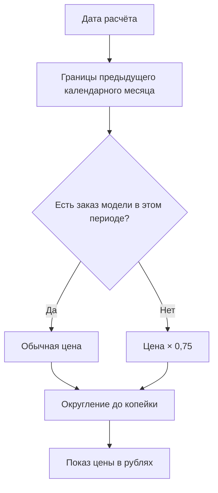
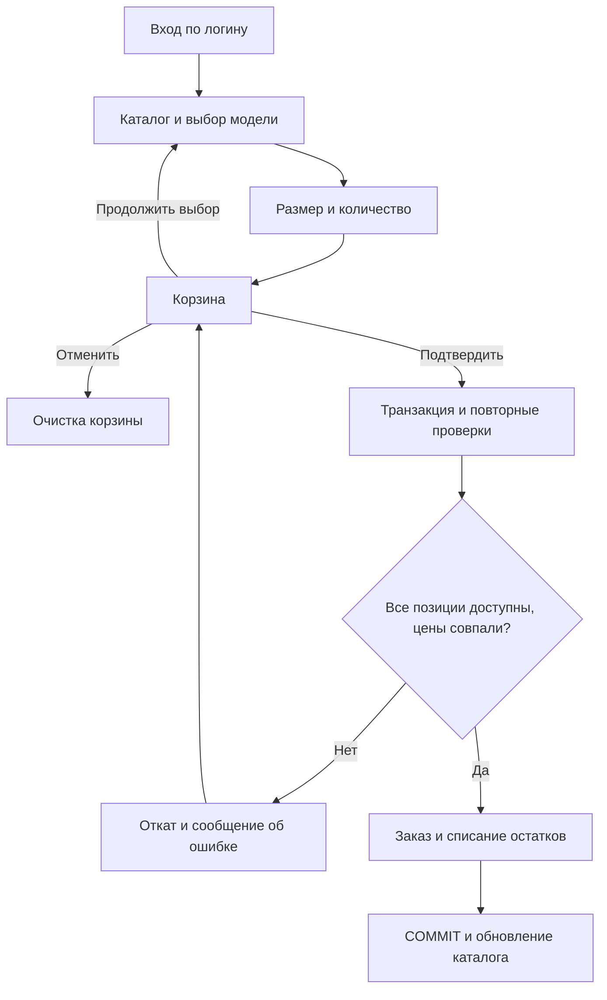

# Алгоритмы

## Скидка

1. Взять дату расчёта. В интерфейсе используется текущая дата Windows.
2. Получить первое число текущего месяца и первое число предыдущего месяца.
3. Найти хотя бы одну строку заказа данной модели с датой `>= начало предыдущего месяца` и `< начало текущего месяца`. Проверяются все размеры модели.
4. Если такая строка найдена, использовать обычную цену; иначе применить 25% скидки.
5. Рассчитать цену в копейках: `Round(базовая_цена × 0,75, AwayFromZero)`. Отобразить цену в рублях с двумя десятичными знаками.

Например, для 16.10.2026 проверяется период `[01.09.2026; 01.10.2026)`, а для 01.01.2027 — `[01.12.2026; 01.01.2027)`. Это календарный месяц, а не последние 30 дней.

Реализация: `Pricing` в `Models.cs`; поиск заказов — `GetProducts` и `CreateOrder` в `Store.cs`. Скидка повторно вычисляется при оформлении, поэтому клиентский объект не может задать произвольную цену.

## Оформление заказа

1. Авторизовать пользователя по логину; получить роль из MSSQL.
2. Показать каталог, применить совместно поиск, фильтр и сортировку.
3. При выборе модели загрузить актуальные размеры и остатки.
4. Проверить целое количество, доступность размера и количество уже в корзине. Добавить или объединить позицию по сочетанию модели и размера.
5. В корзине разрешить изменение количества, удаление позиции, возврат в каталог и отказ от заказа.
6. Перед подтверждением обновить цены. Покупатель оформляет на себя, сотрудник может выбрать клиента.
7. Начать транзакцию `SERIALIZABLE`. Повторно проверить роль, клиента и количество.
8. Создать заголовок заказа. Обходить позиции в порядке их идентификаторов, получить блокировку `UPDLOCK, HOLDLOCK` на остатки.
9. Повторно определить скидку и сравнить цену с подтверждённой. Условным `UPDATE ... WHERE available_quantity >= quantity` списать количество.
10. Записать строки с исторической ценой. Если любая проверка не прошла, транзакция откатывает весь заказ и все списания.
11. Зафиксировать транзакцию, очистить корзину, обновить каталог и показать номер заказа.

Наличие блокировок и условного обновления гарантирует, что две попытки покупки последней пары не приведут к отрицательному остатку. При конфликте блокировок MSSQL может отклонить одну попытку; интерфейс предлагает повторить действие.

## Удаление и редактирование

Удаление заказа: проверить роль сотрудника → заблокировать заголовок заказа → вернуть количество строк в остатки → удалить заголовок и каскадно строки → зафиксировать транзакцию → обновить окна.

Удаление позиции: проверить роль администратора → заблокировать заказ → убедиться, что останется минимум одна позиция → вернуть её количество → удалить строку → зафиксировать транзакцию → обновить состав, итог и каталог.

Изменение даты: проверить роль администратора → обновить дату существующего заказа → обновить списки и скидки. Исторические цены не пересчитываются.
